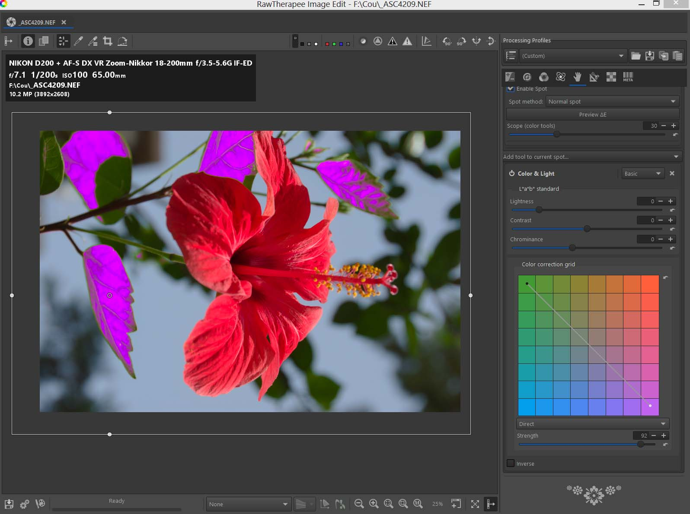
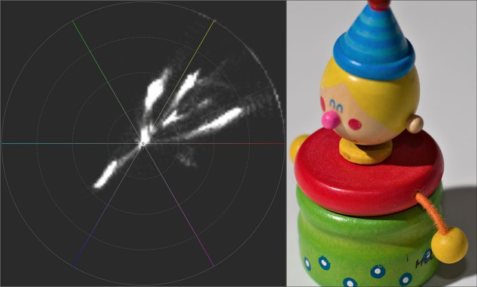
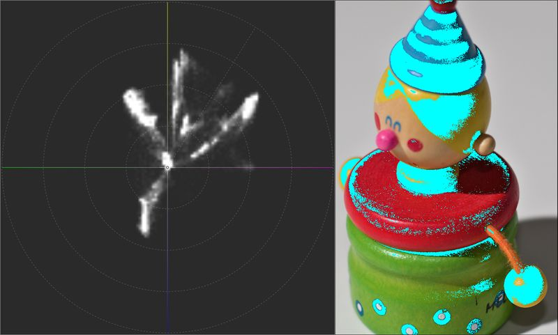
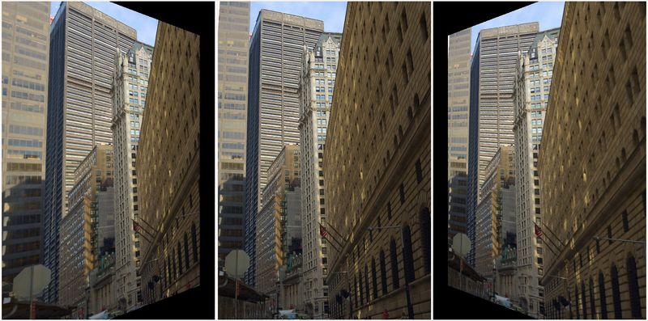
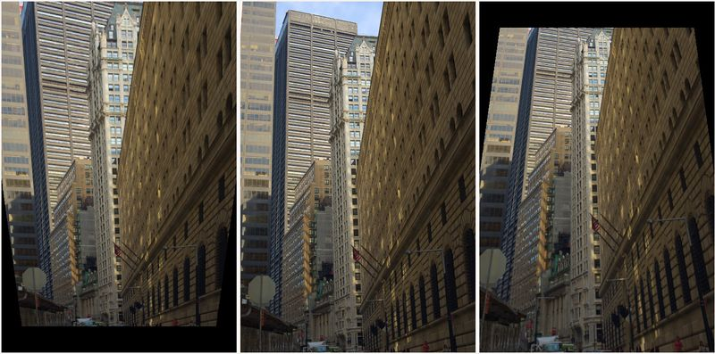
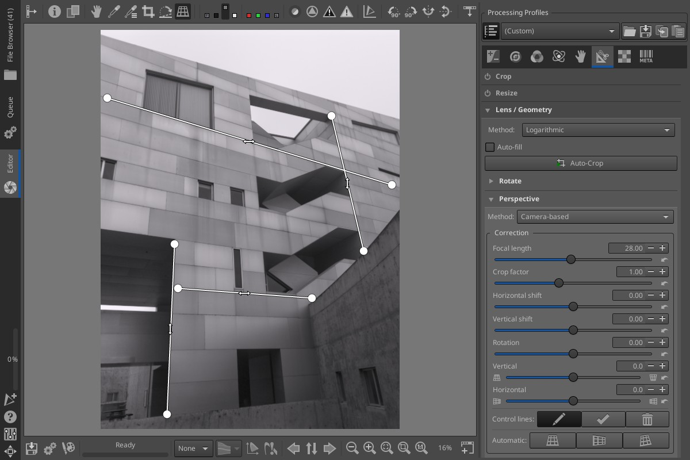
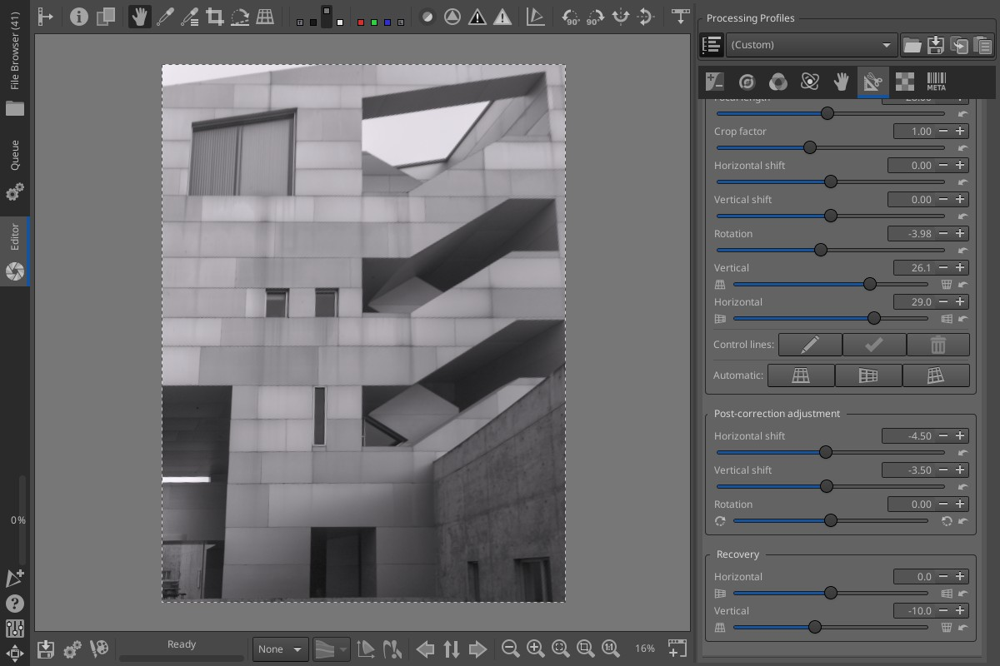
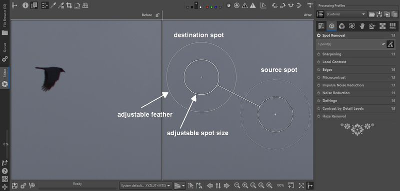

Hi all! This is [Pat David](https://patdavid.net/about/) from [Pixls.us](https://pixls.us/), on behalf of the RawTherapee team with an update.

As you may have noticed, the usual updates of RawTherapee seem to have stalled after version 5.8 was released in February 2020. This feels like _ages_ ago. Normally, the team would release at least two updates per year with new features and many bugfixes. If you have wondered when a new version will arrive, I can tell you: soon! In this post, I will provide a little backstory to the current situation and preview a lot of the upcoming features.

First of all, let's be honest: COVID sucks. The same things that have disrupted the _entire planet_ have similarly disrupted the RawTherapee team. The good thing is, **development has always continued**. Anyone can verify this on [GitHub](https://github.com/Beep6581/RawTherapee) where a number of talented folks are still gradually moving things forward. Unfortunately, the project maintainer became unavailable and getting a new release out has therefore been nearly impossible. People are doing everything they can to get everything ready to release version 5.9 as soon as possible.

There are plenty of new things to look forward to as I will show you in the rest of this post. Most importantly, **all these features are already available** for you to use in the [official nightly builds on GitHub](https://github.com/Beep6581/RawTherapee/releases/tag/nightly-github-actions) (Linux and Windows). This is the _de facto_ new version of the software, until 5.9 comes out. Please read that page for further instructions. The [macOS builds](https://keybase.pub/kd6kxr/) are freely provided by [@Benitoite][].

_Note:_ There is an active community of RawTherapee users and developers on the [Pixls Forum](https://discuss.pixls.us). Most of this post is compiled from community contributions as discussed in more detail [here](https://discuss.pixls.us/t/the-problem-with-no-releases/29781). Thank you to [@Lawrence37][], [@Desmis][], and many others for providing me a list of the great work the team has been doing along with the extensive ["WIP Release notes (v5.9)"](https://github.com/Beep6581/RawTherapee/discussions/6331) compiled by [@Thanatomanic][].

Speaking of which, [@Thanatomanic][] listed _28_ distinct developers that have contributed (some or a lot of) code to the project in the last two years. Credit, where credit is due, to (in alphabetical order): [@10110111][], [@adamreichold][], [@Benitoite][], [@Bezierr][], [@CarVac][], [@Desmis][], [@dheijl][], [@EwoutH][], [@ff2000][], [@Floessie][], [@freddii][], [@heckflosse][], [@jonathanBieler][], [@kdm9][], [@Lawrence37][], [@luzpaz][], [@mkyral][], [@Pandagrapher][], [@pinchartl][], [@purew][], [@rfranke][], [@rom9][], [@shapirus][], [@SimonSegerblomRex][], [@stwunsch][], [@Thanatomanic][], [@ya-isakov][], [@ylep][].

Now let's have a look at some of the awesome new features coming!

## Local Adjustments
Note: [RawPedia](https://rawpedia.rawtherapee.com/Local_Adjustments) has much more detailed explanations and examples of this new feature.

**Main developers:** Jacques Desmis, Ingo Weyrich, Pierre Cabrera  
**Main contributors:** Wayne Sutton, Jacques Dekker, Andy Astbury

A *very* exciting addition to the development versions leading up to 5.9 is the inclusion of a _Local Editing_ capability.
This allows for some complex local masking to be used for application of various tools based on shape detection performed with ΔE (color differences) using the RT-spots algorithm developed by [Jacques Desmis](https://github.com/Desmis).

This is similar to the U-Point concept originally used in Nikon Capture N2 and subsequently in Nik Collection, DxO Photolab, and Capture NXD. The approach is very different from other tools (GIMP, Photoshop) such as a _lasso_ or _magic wand_ approach to selecting regions in an image where selections are coupled with masks and blending to produce a desired effect. The creation of these selections can be time-consuming and tedious depending on how complex they should be.

<figure>

<figcaption>
Example of working on the full image (changing color of the leaves).
</figcaption>
</figure>

The tool provides users the ability to choose the level of complexity they want when working as _Basic_, _Standard_, or _Advanced_.

RT-spots considers either an ellipse or rectangle as a base area and then uses reference values within to provide an average of hue, chroma, and luminance values to the shape detection algorithm. The modifications that can be made include most of the functions available in RawTherapee's global adjustment tools along with some additional tools available only for Local Adjustments. RT-spots can also be used in exclusion mode to _prevent_ the algorithm from influencing certain parts of the image. Furthermore, all adjustments can also be applied to the _full image_ instead of a _spot_.

<figure>

<figcaption>
Selecting the area and points.
</figcaption>
</figure>

<figure>

<figcaption>
Preview of the modifiable area selection.
</figcaption>
</figure>

There's a number of great examples available on the [RawPedia page](https://rawpedia.rawtherapee.com/Local_Adjustments) for many scenarios including:

 * [Example: changing the color of all the green leaves, except for one](https://rawpedia.rawtherapee.com/Local_Adjustments#Example:_changing_the_color_of_all_the_green_leaves.2C_except_for_one)
 * [Correcting red-eye and removing sensor defects](https://rawpedia.rawtherapee.com/Local_Adjustments#Correcting_red-eye_and_removing_sensor_defects)
 * [Dodging and Burning](https://rawpedia.rawtherapee.com/Local_Adjustments#Dodging_and_Burning)
 * [Making a graduated filter based on luminance, chrominance and hue (gradient filter)](https://rawpedia.rawtherapee.com/Local_Adjustments#Making_a_graduated_filter_based_on_luminance.2C_chrominance_and_hue_.28gradient_filter.29)
 * [Five ways to change the exposure and lift the shadows](https://rawpedia.rawtherapee.com/Local_Adjustments#Five_ways_to_change_the_exposure_and_lift_the_shadows)
 * [HDR to SDR: A first Approach (Log Encoding - Cam16 - JzCzHz - Sigmoid)](https://rawpedia.rawtherapee.com/Local_Adjustments#HDR_to_SDR:_A_First_Approach_.28Log_Encoding_-_CAM16_-_JzCzHz_-_Sigmoid.29)
 * and many more!

This new feature brings a very quick and intuitive way to mask and edit local areas in images and is well worth grabbing a copy of the development version to try out!

## Abstract Profiles
**Main developers:** Jacques Desmis, Ingo Weyrich  
**Main contributors:** Wayne Sutton, Andy Astbury

(Color is a complex topic that I (Pat) am not even remotely qualified to speak with any authority on. [@Desmis][] has explained a summary of the main features of this feature and the explanations are available in-depth [on the RawPedia Color Management page](https://rawpedia.rawtherapee.com/Color_Management#Abstract_Profiles).
Any errors or mistakes in describing this feature are my own.)

Abstract profiles allow you to perform custom image effects to your image (such as applying a particular "look" or "style"). This profile will allow you to define CIELAB or CIEXYZ values as both _Input_ and _Output_ - you can algorithmically define what color changes you like and produce a corresponding Look Up Table (LUT).
This is accomplished using Virtual profiles in Little Color Management System, [LCMS][].

[LCMS]: https://www.littlecms.com/

This means you can adjust:

 * **Tone Response Curve, TRC:**
   You can adjust the gamma and slope to modify the image rendering (by default it's gamma = 2.4 and slope = 12.92). It allows raising the shadows and modifying the lighter tones in an image while preserving the colorimetry and gamut.
 * **Illuminant (white point):**
   Adjust the gamut of the working profile to adapt it to the shooting conditions while taking into account the colorimetry.
	 If an image is taken at 4000K in sRGB (which is D65), the gamut may not be suitable. The joint action of the illuminant and CIECAM (symmetrical mode) allows you to ensure a good chromatic adaptation.
	 It can be used in conjunction with the modification of the Primaries as well (below).
 * **Primaries:**
   This is where the notion of Abstract profiles shines.
	 Several possibilities are available:
	 1. Using this module as a Channel Mixer to create special effects similar to Color Toning (with or without CIECAM).
	 2. Modify or refine the result of the Input Profile to improve the colorimetry (calibration).

Abstract profiles do not modify the Working profile, Input profile, or the Output profile. They _do_ modify data in the same way as other RawTherapee algorithms. It works as a patch at the end of the pipeline (just before CIECAM and just before conversion to a screen profile or an Output profile) that acts on the 3 components of the ICC profile (Tone Response Curve, Illuminant (white point), and Primaries).

## Waveform and Vectorscope
**Main developers:** Lawrence Lee, Ingo Weyrich  
**Main contributors:** Javier Bartol, Paco Lorés, Andy Astbury

There are also new ways to inspect what the colors in an image are doing beyond a 'classic' histogram view.
Most users would probably be familiar with a histogram that shows the distribution of the Red, Green, and Blue pixels of the image (usually along with the luminosity):

<figure>

</figure>

There is now also available the _Waveform Analyzer_ (waveform) to inspect the distribution of colors in an image. This is a special representation of the RGB channels which shows the position of the pixels horizontally and the value of each pixel vertically and through a more vivid or duller tone the number of pixels with each value.

<figure>

<figcaption>
Waveform of the displayed image. The shape of the wave in the padlock area is especially descriptive, in contrast to the right half, which corresponds to gray wood.
</figcaption>
</figure>

There are also _vectorscopes_ in addition to the _waveform_ analyzer.
There are two types available, **HS Vectorscope** which displays pixel colors according to the [HSL color space](https://en.wikipedia.org/wiki/HSL_and_HSV) and **HC Vectorscope** that uses [Lch color space](https://en.wikipedia.org/wiki/HCL_color_space).

<figure>

<figcaption>
An HS vectorscope where you will see that there are 3 axes that point to the colors red, yellow, green, cyan, blue and magenta.
</figcaption>
</figure>

<figure>

<figcaption>
The HC vectorscope where you see the most saturated colors reaching approximately the value 85. Specifically, they are the red and yellow tones.
</figcaption>
</figure>

## Camera-based Perspective Correction
**Main developers:** Lawrence Lee, Flössie  
**Main contributors:** Roel Baars, Ingo Weyrich, Maciek Dworak

The simple manual approach for the perspective tool has now been augmented with a more powerful "camera-based" guided (or automated) perspective correction tool that considers the field-of-view of the image and the offset from the optical center to produce a physically correct perspective correction.

The focal length and crop factor are combined, automatically inferred from the image metadata, but can be adjusted manually if necessary. (The user is still needs to account for any cropping not already factored into the focal length and crop factor metadata - by increasing the crop factor and using horizontal/vertical shift to re-align the image center with the optical center). There is also a rotation option (different from the *Rotate* tool in that it is applied after the horizontal/vertical shifts.

<figure>

<figcaption>
Horizontal perspective correction example.
</figcaption>
</figure>

<figure>

<figcaption>
Vertical perspective correction example.
</figcaption>
</figure>

[@Lawrence37][] provided this awesome example using control points on the forum:

<figure>

<figcaption>
Drawing control lines on the image to correct perspective in both directions.
</figcaption>

 

<figcaption>
The result of applying the correction (with some recovery).
</figcaption>
</figure>

As [@Lawrence37][] describes in the forum:

 * There are three buttons for automatically detecting lines in the image and correcting the perspective in the vertical direction, horizontal direction, or both. Automatic correction works well in most cases where the image has visible horizontal and/or vertical lines.

 * In case the automatic option fails to find lines or gets confused by irrelevant lines, the user can opt for the control lines option. The user draws lines over the image. When complete, RawTherapee will use those lines to calculate the correction. As long as there are at least two lines in the same direction as the correction direction, correction will be applied. This means it is possible to control which direction(s) get automatically adjusted by drawing the appropriate number of lines in the corresponding direction.

 * After correcting the perspective, users can make some final adjustments to the rotation, shift, and perspective recovery. The recovery option is particularly useful if a perfect correction is not desirable. For example, an image of a building may look strange if the building does not “lean back” slightly. One possible remedy is to reduce the amount of correction. This technique leads to a problem if perspective correction is applied in both directions or if post-correction rotation/shift are used; The lean will be tilted to one side. The solution is to use recovery, which ensures the lean is always centered.

While testing this myself I tried the _automatic_ option and the results were perfect in just one click. Great work from the team!

## Full-screen/Detached Inspector

**Main developers:** Rüdiger Franke, Lawrence Lee, Ingo Weyrich  
**Main contributors:** Roel Baars, Javier Bartol

Directly from [@Lawrence37][] on [the thread in the forums](https://discuss.pixls.us/t/rawtherapee-website-release-post-aka-were-not-dead-yet/31565/30#full-screendetached-inspector-1) about using the new Full-screen/Detached Inspector:

> In the preferences, the full-screen inspector can be activated. When enabled, the inspector tab on the right panel of the file browser no longer appears. Instead, it is invoked by hovering the cursor over an image, then pressing and holding the f key. A new window will appear showing the entire embedded image in full-screen. Letting go of the f key will close the inspector window. Alternatively, pressing and holding Shift-f opens the inspector with the image at 100% zoom.
>
> Clicking anywhere inside the inspector window while it is open will pin it. This allows further inspection of the image by panning (click-and-drag) and zooming (scrolling). Pressing f or Shift-f will fit the image to the window and zoom to 100%, respectively. The pinned inspector behaves like a normal window. This means it is possible to toggle the full-screen status, resize it, and move it around. The inspector can even be placed on a different screen for multi-monitor setups.
>
> The detached inspector retains the image navigation of the tabbed inspector. By moving the cursor over the thumbnails in the file browser, one can inspect various regions of the image or switch between images.

## Improved Film Negative

**Main developers:** Alberto Romei, Flössie  
**Main contributors:** Roel Baars

Film Negative was added back in RawTherapee 5.7 to invert raw images of film negatives (while accounting for the light response properties of film).
It has now been revamped with quicker updating of previews while making adjustments and it no longer needs to be a raw image being edited. (Note that _Film Negative_ is now in the **Color** tab).

The white balance has now been split into two parts.
The first stage is for setting the proper white balance for the backlight using the standard White Balance tool and after the inversion the white balance of the scene in the film can be adjusted within the **Film Negative** tool.

## Spot Removal

**Main developers:** Jean-Christophe Frisch, Ingo Weyrich, Lawrence Lee  
**Main contributors:** Roel Baars, Andy Astbury

The **Spot Removal** tool can be used to sample from other regions of an image to mask areas of interest (blemishes or sensor dust for instance).

<figure>

<figcaption>
Removing the bird (after on right).
</figcaption>
</figure>

A line connects the sample area to the replacement area for reference. The inner circle represents the area being replaced while the outer circle is the extents of the feathering that is used to blend the replacement into the surrounding area.

## Color-Correlation Automatic White Balance
**Main developers:** Jacques Desmis, Ingo Weyrich  

From Jacques ([@Desmis](https://github.com/Desmis)) and Ingo ([@heckflosse](https://github.com/heckflosse)) comes a brand new algorithm (from scratch!) for white balance, the _Iterative Temperature Correlation White Balance_, itcwb).

Note: I am borrowing heavily from the [RawPedia page describing this algorithm](http://rawpedia.rawtherapee.com/White_Balance#Simplified_.22Itcwb.22algorithm:).

> Put simply, the algorithm compares a large number of sample colors in the image with a set of reference colors and their associated spectral data.

The algorithm "Iterative Temperature Correlation WB" is based on a comparison of the raw data of the image and a base of 200 colors representative of the visible colors in spectral data.
Through several iterative steps it uses the correlation of this data to:

 * search for the best Temperature
 * search for the best green point (tint)

The system gives good (or _very_ good) results when the illuminant of the scene, during shooting, is either "Daylight" (between 4100K and 12000K) or "Blackbody" (between 2000K and 4100K).

### A More Detailed Explanation (for the curious)
This algorithm divides the process into three phases:

1. xyY comparison
2. spectral data analysis
3. color histogram analysis

Simplified:

#### Step One

 * Calculate the RGB multipliers for each temperature between 2000K and 12000K and for the tint.
 * Calculate the XY values from the 200 spectral-data values for each temperature.
 * Select a temperature data range relative to the reference.
 * Calculate the XY values in the form of a histogram and select from among the 158 possible values, the most commonly used colors (skin, sky, etc.) for each temperature.
 * Sort the data in ascending numerical order.
 * For the most frequently occurring data values, calculate the chromatic values of the image.
 * Use the deltaE chroma values to select the reference colors from the 200 available possibilities.
 * Calculate the reference RGB values as a function of the reference temperature.

#### Step Two

 * Calculate the XY values for each selected reference color as a function of temperature and tint.
 * Calculate the RGB values of the image from the XY values using the RGB multipliers.
 * First calculation of the Student correlation.
 * For each tint and temperature range, calculate the channel multipliers and the XY values from the corresponding spectral data.
 * Calculate the correlation coefficient as a function of the color green.
 * Sort these values.
 * Optimize the values to determine the correct temperature and tint values.
 * Send these parameters to "wbauto”.
 * Display the results and update Improccoordinator.cc.

## Dual-Demosaic with Bilinear
**Main developer:** Ingo Weyrich  

There are already dual-demosaic options in RawTherapee that blend the results from different algorithms together based on the region - the algorithm better suited for fine details is used on high-contrast areas of the image while the algorithm best suited for smooth regions is used on low-contrast areas. Bilinear is a fast method well suited for low-contrast, smooth regions so there are three new dual-demosaic options that can combine Bilinear with AMaZE, RCD, and DCB.

## Wavelet Improvements
**Main developers:** Jacques Desmis, Ingo Weyrich  
**Main contributors:** Wayne Sutton, Andy Astbury, Javier Bartol

Wavelets have been greatly improved and now include an "Attenuation Response" for control.

Attenuation Response now makes wavelets usable in most cases without adding artifacts.
As [@Desmis][] [describes](https://discuss.pixls.us/t/rawtherapee-website-release-post-aka-were-not-dead-yet/31565/55), it looks for the maximum of a signal (for each level, dimension), calculates a standard deviation, and from these two values it concentrates the actions on the most pronounced "central" part of the signal. Attenuation Response allows us to reduce or increase this "central" part as well as offset/move it.

Several modules have had big changes by the addition of this function such as _Constrast_, _Chroma_, and other modules.

 * The _Toning_ module has been upgraded with the ability to graphically visualize changes.

 * The _Denoise_ module is clearly improved but is limited in the number of levels of decomposition (memory and processing time). It includes an Advanced mode with complex optimization functions to improve the results. It also now includes a _Chroma_ module.

 * _Edge Sharpness_, which increases the contrast on edges, is also improved.

 * There is a new _Blur Levels_ module.

 * _Residual Image_ has also been improved, in particular with the "Blur" function and a new "Clarity" module.

 * _Final Touchup_ has also been significantly improved, in particular by the "Directional contrast" function which acts to differentiate the response of the 3 wavelet decompositions (horizontal, vertical, diagonal) and _Final smoothing_ which allows you to attenuate images that are too "hard".

Compared to **Local Adjustments** many modules seem similar, but because of the number of levels and ΔE [@Desmis][] feels the performances of Local Adjustments are superior. Functions have been added in Local Adjustments such as "Graduated Filter" that acts on the contrast (in the wavelet sense), "Tone mapping" - another approach to the usual algorithms which with negative values allows you to simulate a "dodge & burn" and of course masks and functions related to the masks such as "Recovery base on luminance" mask.

## macOS app
[@Benitoite][] also added an update to the macOS app for users of macOS 10.15+ that encountered stronger integrity protections for apps. The RawTherapee app for macOS now uses the standard Apple LaunchServices bundle structure (instead of a shell script) and the app is now hardened, sandboxed, signed by [@Benitoite][] and notarized by Apple.

## And More!
As usual, there have been countless bugfixes and smaller improvements to the software. Importantly, camera support has increased to include the processing of files from ProRaw, EOS R5, EOS R6, EOS RP, GFX 100, Z5, Z50, and others.

For everything else, please stay tuned for version 5.9. It is coming!

[@Lawrence37]: https://github.com/Lawrence37
[@Thanatomanic]: https://github.com/Thanatomanic
[@10110111]: https://github.com/10110111
[@Benitoite]: https://github.com/Benitoite
[@Bezierr]: https://github.com/Bezierr
[@CarVac]: https://github.com/CarVac
[@Desmis]: https://github.com/Desmis
[@EwoutH]: https://github.com/EwoutH
[@Floessie]: https://github.com/Floessie
[@Pandagrapher]: https://github.com/Pandagrapher
[@purew]: https://github.com/purew
[@SimonSegerblomRex]: https://github.com/SimonSegerblomRex
[@Thanatomanic]: https://github.com/Thanatomanic
[@adamreichold]: https://github.com/adamreichold
[@dheijl]: https://github.com/dheijl
[@ff2000]: https://github.com/ff2000
[@heckflosse]: https://github.com/heckflosse
[@jonathanBieler]: https://github.com/jonathanBieler
[@kdm9]: https://github.com/kdm9
[@luzpaz]: https://github.com/luzpaz
[@mkyral]: https://github.com/mkyral
[@pinchartl]: https://github.com/pinchartl
[@rfranke]: https://github.com/rfranke
[@rom9]: https://github.com/rom9
[@stwunsch]: https://github.com/stwunsch
[@ya-isakov]: https://github.com/ya-isakov
[@ylep]: https://github.com/ylep
[@freddii]: https://github.com/freddii
[@shapirus]: https://github.com/shapirus
