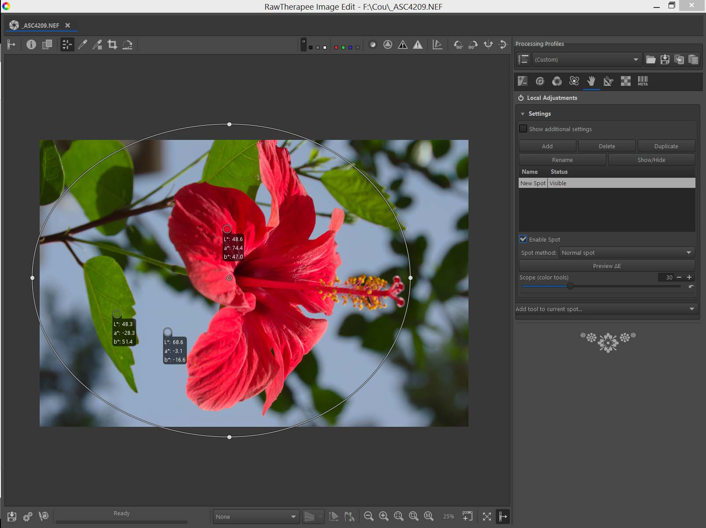
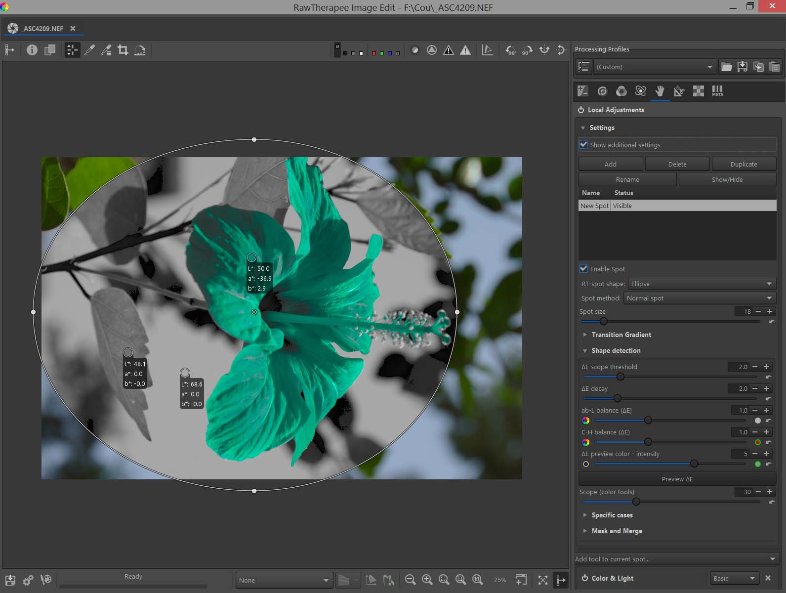
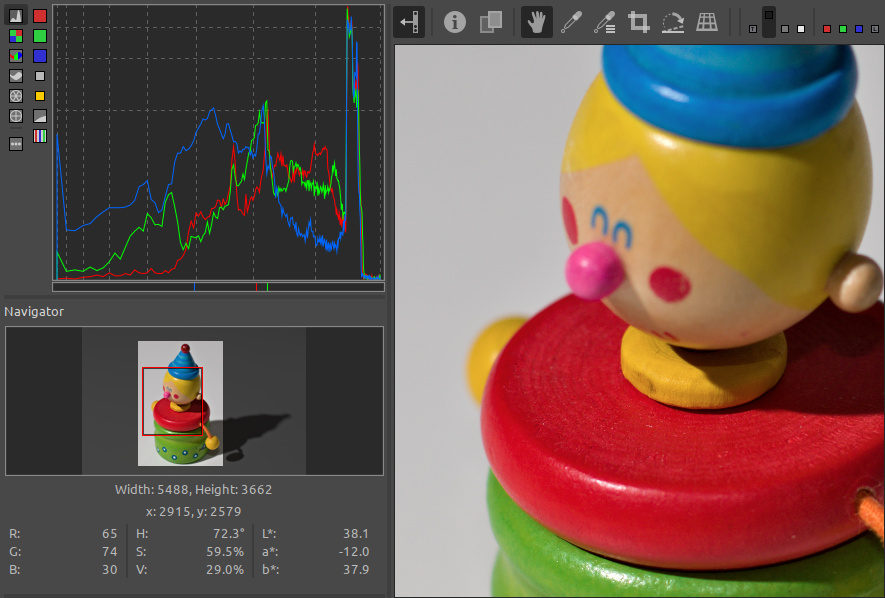
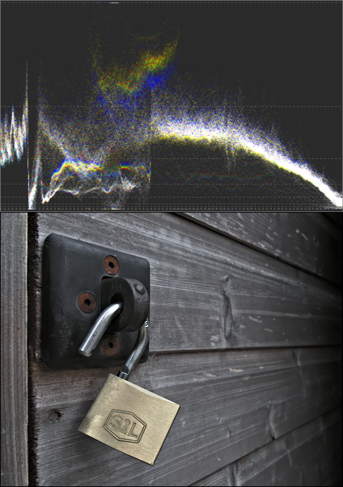

Hi all!  Pat David here with an update for everyone.

Ok, let's be honest: COVID sucks.
The same things that have disrupted the _entire planet_ have similarly disrupted communications channels for the RawTherapee team.

The important thing is that it was mainly the _communications_ channels that were disrupted and **not the development and hacking**.
There are still plenty of talented folks working on the project and moving things forward (we'll get to that in a minute) but without access to DrSlony for the moment we can't really push full releases the way it's been done in the past.
Hence this post.

Most of this post is compiled from the community and contributors who have been working on RawTherapee and tracking progress.
It was brought up recently in the forum thread ["The Problem with No Releases"](https://discuss.pixls.us/t/the-problem-with-no-releases/29781) and [@Lawrence37][] provided me a list of the great work the team has been doing (for over two years now) along with the ["WIP Release notes (v5.9)"](https://github.com/Beep6581/RawTherapee/discussions/6331) discussion where [@Thanatomanic][] compiled many many PRs and work that's been done in greater detail with links.

Speaking of which, here is what [@Thanatomanic][] assembled in that Github discussion:

Based on the merged PR's, there have been valuable contributions by (in alphabetical order) 

[@Lawrence37]: https://github.com/Lawrence37
[@Thanatomanic]: https://github.com/Thanatomanic

  * [@10110111](https://github.com/10110111)
  * [@Benitoite](https://github.com/Benitoite)
  * [@Bezierr](https://github.com/Bezierr)
  * [@CarVac](https://github.com/CarVac)
  * [@Desmis](https://github.com/Desmis)
  * [@EwoutH](https://github.com/EwoutH)
  * [@Floessie](https://github.com/Floessie)
  * [@Lawrence37](https://github.com/Lawrence37)
  * [@Pandagrapher](https://github.com/Pandagrapher)
  * [@purew](https://github.com/purew)
  * [@SimonSegerblomRex](https://github.com/SimonSegerblomRex)
  * [@Thanatomanic](https://github.com/Thanatomanic)
  * [@adamreichold](https://github.com/adamreichold)
  * [@dheijl](https://github.com/dheijl)
  * [@ff2000](https://github.com/ff2000)
  * [@heckflosse](https://github.com/heckflosse)
  * [@jonathanBieler](https://github.com/jonathanBieler)
  * [@kdm9](https://github.com/kdm9)
  * [@luzpaz](https://github.com/luzpaz)
  * [@mkyral](https://github.com/mkyral)
  * [@pinchartl](https://github.com/pinchartl)
  * [@rfranke](https://github.com/rfranke)
  * [@rom9](https://github.com/rom9)
  * [@stwunsch](https://github.com/stwunsch)
  * [@ya-isakov](https://github.com/ya-isakov)
  * [@ylep](https://github.com/ylep)

and two honorable mentions for 
  * [@freddii](https://github.com/freddii) and
  * [@shapirus](https://github.com/shapirus) who both added one single line to the codebase.

## Local Adjustments
Note: [RawPedia](https://rawpedia.rawtherapee.com/Local_Adjustments) has much more detailed explanations and examples of this new feature.

A *very* exciting addition to the development versions leading up to 5.9 is the inclusion of a _Local Editing_ capability.
This allows for some complex local masking to be used for application of various tools based on shape detection performed with ΔE, or the change in visual perception between two given colors, using the RT-spots algorithm developed by [Jacques Desmis](https://github.com/Desmis).

This is similar in principle to the U-Point concept originally used in Nikon Capture N2 and subsequently in Nik Collection, DxO Photolab, and Capture NXD.
The approach is very different from other tools (GIMP, Photoshop) such as a _lasso_ or _magic wand_ approach to selecting regions in an image where selections are coupled with masks and blending to produce a desired effect.
The creation of these selections can be time-consuming and tedious depending on how complex they should be.

RT-spots uses either an ellipse or rectangle for a base area of consideration and then uses reference values inside that shape to provide an average of hue, chroma, and luminance values to the shape detection algorithm.
The modifications that can be done include most of the functions available in RawTherapee's global adjustment tools along with some additional tools available only for Local Adjustments.
RT-spots can also be used in exclusion mode to _prevent_ the algorithm from influencing certain parts of the image.

<figure>

<figcaption>
Selecting the area and points.
</figcaption>
</figure>

<figure>

<figcaption>
Preview of the modifiable area selection.
</figcaption>
</figure>

There's a number of great examples available on the [RawPedia page](https://rawpedia.rawtherapee.com/Local_Adjustments) for many scenarios including:

 * [Example: changing the color of all the green leaves, except for one](https://rawpedia.rawtherapee.com/Local_Adjustments#Example:_changing_the_color_of_all_the_green_leaves.2C_except_for_one)
 * [Correcting red-eye and removing sensor defects](https://rawpedia.rawtherapee.com/Local_Adjustments#Correcting_red-eye_and_removing_sensor_defects)
 * [Dodging and Burning](https://rawpedia.rawtherapee.com/Local_Adjustments#Dodging_and_Burning)
 * [Making a graduated filter based on luminance, chrominance and hue (gradient filter)](https://rawpedia.rawtherapee.com/Local_Adjustments#Making_a_graduated_filter_based_on_luminance.2C_chrominance_and_hue_.28gradient_filter.29)
 * [Five ways to change the exposure and lift the shadows](https://rawpedia.rawtherapee.com/Local_Adjustments#Five_ways_to_change_the_exposure_and_lift_the_shadows)
 * [High dynamic range images - use Log Encoding or the "PDE" algorithms in the "Dynamic Range & Exposure" tool](https://rawpedia.rawtherapee.com/Local_Adjustments#High_dynamic_range_images_-_use_Log_Encoding_or_the_.22PDE.22_algorithms_in_the_.22Dynamic_Range_.26_Exposure.22_tool)
 * and many more!

This new feature brings a very quick and intuitive way to mask and edit local areas in images and is well worth grabbing a copy of the development version to try out!

## Waveform and Vectorscope
There are also new ways to inspect what the colors in an image are doing beyond a 'classic' histogram view.
Most users would probably be familiar with a histogram that shows the distribution of the Red, Green, and Blue pixels of the image (usually along with the luminosity):

<figure>

</figure>

There is now also available the _Waveform Analyzer_ (AFO, waveform) to inspect the distribution of colors in an image.  This is a special representation of the RGB channels which shows the position of the pixels horizontally and the value of each pixel vertically and through a more vivid or duller tone the number of pixels with each value.

<figure>

<figcaption>
AFO of the displayed image. The shape of the wave in the padlock area is especially descriptive, in contrast to the right half, which corresponds to gray wood. 
</figcaption>
</figure>

## Camera-based Perspective Correction

## Full-screen/Detached Inspector

## Improved Film Negative

## Spot Removal

## Color-Correlation Automatic White Balance

## Dual-Demosaic with Bilinear

