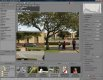
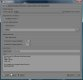
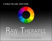

Raw Therapee is a free RAW converter and digital photo processing
software.

#### Main features :

  - Selectable high performance demosaicing algorithms (EAHD and HPHD
    and VNG-4).  
    Compare them on this [comparison
    page](http://www.rawtherapee.com/RAW_Compare/ "Comparison of various RAW demosaicing methods").
  - Using DCRaw 8.82/1.398 for decoding RAW images
  - Image post processing in 16 bit / channel mode
  - Exposure control in RGB space
  - Auto exposure with adjustable clipping point / Exposure compensation
    / Shadow and highight compression / Contrast adjustment, curve
    editor
  - White balance adjustment in RGB space
  - With in-camera, automatic and spot white balance options /
    Temperature/Green tint fine tuning
  - Highlight Recovery
  - Shadows/Highlights control in RGB space
  - Basic Luminance curve tool to modify the luminance channel in CIELab
    color space
  - Brightness / Contrast adjustment, curve editor
  - USM sharpening applied on the CIELab luminance channel
  - Classical USM parameters (Radius, Amount, Threshold) / Option to
    avoid noise amplification / Sharpening halo control
  - Optional RL Deconvolution based sharpening for even better
    sharpening results
  - Color shift control in CIELab color space
  - Allows color shift by shifting the CIELab "a" and "b" channels
  - Color booster applied on the CIELab "a" and "b" channels  
    Amplifies color channels "a" and "b" together or separately / Avoids
    color overamplification in high chrominance areas / Option to avoid
    clipping caused by too high color boosting
  - Luminance denoising algorithm applied on the CIELab luminance
    channel
  - Edge sensitive method to preserve as much details as possible
  - Color denoising tool applied on the CIELab "a" and "b" channels
  - Classical gaussian blur or edge sensitive bluring of the color
    channels
  - Fast switching between different postprocessing profiles
  - Image flipping horizontally or vertically, rotation by 90 degrees
    clockwise or counter clockwise
  - Arbitrary image rotation (straightening tool) with fill function or
    automatic crop
  - Simple lens distortion correction
  - Crop tool
  - Chromatic Aberration correction tool
  - Channel Mixer for Red, Green and Blue channels
  - C/A Correction
  - Vignetting Correction
  - ICC based color management
  - Change History with bookmarks to support before/after checking
  - Supported output file formats:  
    JPEG (8 bit), PNG (8 or 16 bit), TIFF (8 or 16 bit)
  - Image ouput size could be set
  - EXIF data is preserved in JPEG output (except crw files)
  - Output directory and automatic file naming highly customizable
  - File browsing with thumbnails
  - Localization supported (utf8 language file):  
    already included languages are: czech, deutsch, english, espanol,
    italian, latvian, magyar, nederlands, polish, russian, slovak,
    swedish

