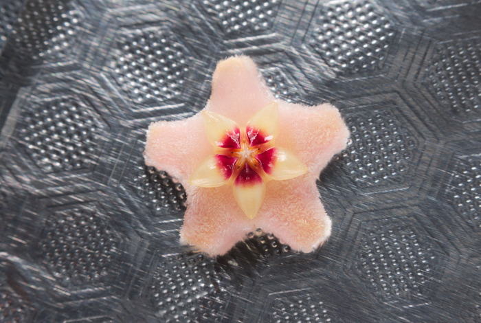

Try your hand at developing a raw image by taking part in the latest
edition of our competition, PLAY RAW 42\! This round's image is from
myself, DrSlony, and it's a macro of a tiny flower which, hanging
upside-down from the plant together with 18 other flowers just like it
in a bunch, produces a drop of sticky liquid every morning to, I
presume, lure pollinating insects in. Can you identify the genus or
species?

\-- Identified by Ingo as [Hoya
carnosa](http://en.wikipedia.org/wiki/Hoya_carnosa "Hoya carnosa on Wikipedia")  
 

<figure>

</figure>

This is what my image looks like with the
"[Default](http://rawpedia.rawtherapee.com/Default "RawPedia article on the Default processing profile")" [processing
profile](http://rawpedia.rawtherapee.com/Sidecar_Files_-_Processing_Profiles "RawPedia article on Sidecar Files - Processing Profiles").

[Take part in PLAY RAW 42
now\!](http://rawtherapee.com/forum/viewtopic.php?f=11&t=5530 "Forum of PLAY RAW 42")

