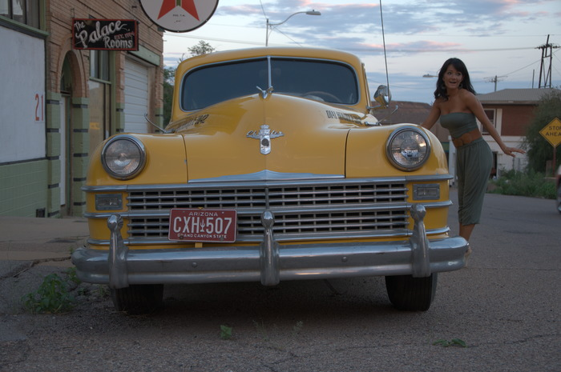

Try your hand at developing a raw image by taking part in the latest
edition of our competition, PLAY RAW 43\! This round's image is from
TooWaBoo.

"This picture was taken
in [Bisbee](http://goo.gl/aupT5t "Bisbee on Google Maps"), Arizona,
near the Mexican border. Bisbee was founded as a copper, gold, and
silver mining town. Today many dropouts and artist live there. It has
its own brewery, old houses and nice little bars with live music every
day. The atmosphere feels like 70 years ago. The people are friendly and
very open minded."

<figure>

</figure>

This is what the image looks like with the "Neutral" [processing
profile](http://rawpedia.rawtherapee.com/Sidecar_Files_-_Processing_Profiles "RawPedia article on Sidecar Files - Processing Profiles").

[Take part in PLAY RAW 43
now\!](http://rawtherapee.com/forum/viewtopic.php?f=11&t=5600#p38428 "Forum of PLAY RAW 43")

