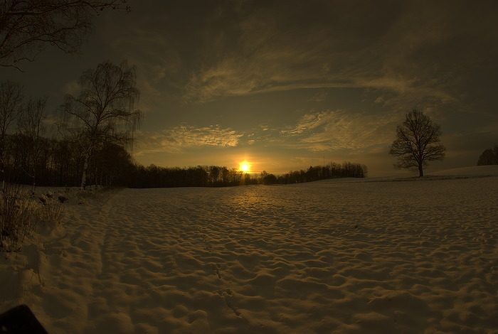

Try your hand at developing a raw image by taking part in the latest
edition of our competition, PLAY RAW 46\! This round's image is from
DrSlony and it is a high dynamic range DNG of a sunrise near Söderåsen
National Park in the south of Sweden.

<figure>

</figure>

This is what the image looks like with the "Neutral" [processing
profile](http://rawpedia.rawtherapee.com/Sidecar_Files_-_Processing_Profiles "RawPedia article on Sidecar Files - Processing Profiles").

[Take part in PLAY RAW 46
now\!](http://rawtherapee.com/forum/viewtopic.php?f=11&t=5904#p40905 "Forum of PLAY RAW 46")

