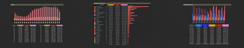
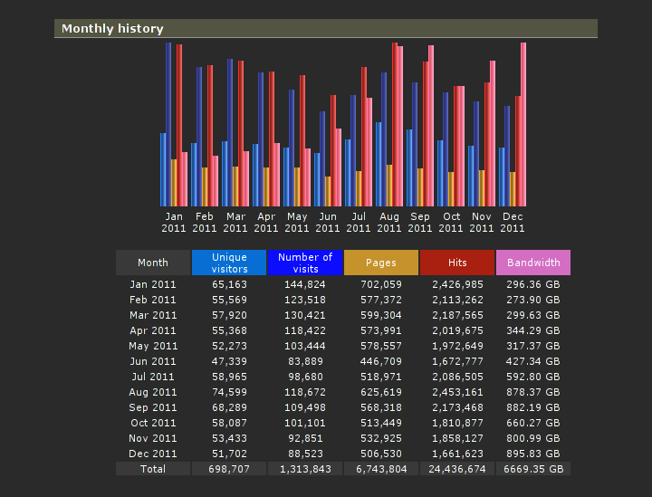
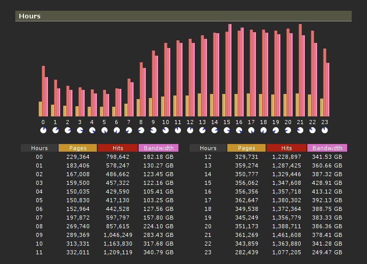
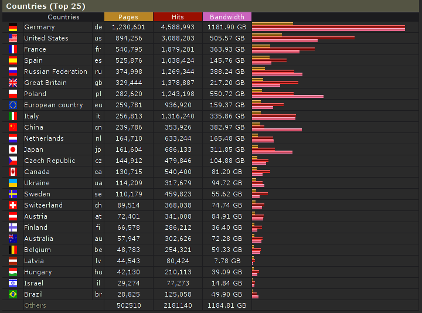

As of today, it's been two years that RawTherapee has been [free open
source
software](http://en.wikipedia.org/wiki/Free_and_Open_Source_Software "Free Open Source Software")
and it has grown tremendously\! Here is a video which visualizes
progress on RawTherapee during these two years, from the 1st of January
2010 till now, the 1st of January, 2012, and some statistics. Enjoy\!  
  
<figure>

</figure>

Created using [Gource](http://code.google.com/p/gource/), watch in 720p
high quality and read the video description at YouTube

# Statistics

## Source code

Date of initial import into Mercurial from the previous source code
repository: Friday, 1 January 2010, 11:52 a.m.

Number of changesets as of 31 December 2011: 1718

Number of files in the repository: 3603 in 138 directories  

Number of lines of code: 160 834 (581 733 words)

## Forum

Date started: Monday, 19 March 2007, 7:11 a.m.

Number of posts: 20 003

Posts per day: 11.44

Number of topics: 2120

Topics per day: 1.21

Number of users: 968

Users per day: 0.55

  

## Website  

#### Most read articles

[Screenshots](http://rawtherapee.com/blog/screenshots "Screenshots section"):
91 049  
[Features](http://rawtherapee.com/blog/features): 79 826  
[RawTherapee documentation](http://rawtherapee.com/blog/documentation):
58 245  
[RawTherapee 3.0.0
released](http://rawtherapee.com/blog/rawtherapee-3.0.0-released): 41
163  
[Maximizing memory
efficiency](http://rawtherapee.com/blog/maximizing-memory-efficiency):
34 320

#### Traffic for 2011

Unique visitors: 698 707

Number of visits: 1 313 843

Pages: 6 743 804

Hits: 24 436 674

Bandwidth: 6669.35GB

Bandwidth per visit: 5322.79kB

Excluded traffic (robots, worms, etc): 730.89GB

<figure>

</figure>

<figure>

</figure>
<figure>

</figure>

