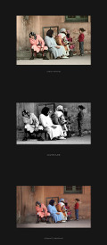

Roughly every three to four weeks we run a new PLAY RAW competition.
Everyone may enter and there is no registration required. Simply check
the "[PLAY RAW
competitions](http://www.rawtherapee.com/forum/viewforum.php?f=11 "PLAY RAW competitions")"
forum for an ongoing competition, read the rules, download the raw file,
develop it using only RawTherapee and submit the JPG and PP3 files to
narvik86 by email. The submission period is two weeks, after which there
is a week for casting votes, and everyone may vote. The winner gets to
submit a photo for the next round of PLAY RAW.

These competitions aren't only about having fun, but also about showing
how wildly different results can be achieved using the same tool in the
hands of different people.

The voting period for [PLAY RAW
13](http://www.rawtherapee.com/forum/viewtopic.php?t=2974 "PLAY 13 voting")
started today, come cast your vote\!

Take part in the next round, perhaps your photo will be the one to make
it to PLAY RAW 15\!

