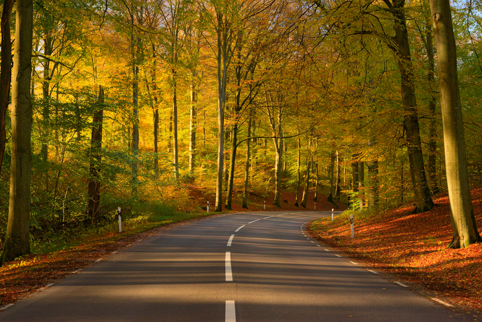

You can help not only RawTherapee, but the open-source photographic
community as a whole, and it won't cost you a dime nor a kidney. You
don't even need to know how to code. Here's how.

<figure>

</figure>

RawTherapee is open-source software, which means we value liberty, and
it's thanks to this principle of liberty that our project exists. We are
not alone. There are other libre projects out there, related to
photography and imaging, and we are friends, and we share our skills for
mutual benefit. Sometimes we even share a beer.

Developing raw photography software requires having access to raw
photographs, and this is where you come in. We have a growing collection
of raw photos from most digital cameras, but there are still some models
and raw file types missing. Chances are that you own one of these
cameras. Take five minutes to read this article and another five minutes
to shoot and send us the raw photos, and you will have helped not only a
handful of programs but also the hundreds of thousands of people who use
them\!

[Raw Samples Wanted - read the
article](https://discuss.pixls.us/t/raw-samples-wanted/5420 "Raw Samples Wanted")

It would also be a big help if you shared this call for raw samples,
told your friends and spread the word in photography circles\!

