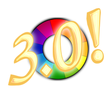

RawTherapee version 2.4.1 was released on the 3rd of September, 2009.
Then on the 4th of January, 2010, Gabor Horvath made RawTherapee open
source. Since then, a team of developers and contributors from around
the world have been busy working towards what we are proud to present to
you today\!

**What's new in RawTherapee-3.0.0:**

  - A new and powerful hue, saturation and value manipulation tool,
  - Speed and quality improvements to all the tools available,
  - More keyboard shortcuts,
  - New dual-monitor interface layout,
  - Automatic and manual chromatic aberration removal tools for pre and
      post-demosaicing,
  - Purple fringe removal tool,
  - Cosmetic interface improvements for low resolution displays,
  - Possibility to ignore a photo's color profile,
  - Auto white balance improved to ignore overexposed areas,
  - Preference to overwrite existing output file or write the new one
      under a different name if one already exists,
  - Ability to change the cropped off area's opacity and color,
  - Thumbnail quality improved,
  - Thumbnail loading speed improved,
  - In single tab mode, the file browser follows the currently open
      photo in the editor tab,
  - New preview size button: "fit"
  - International character support in filenames and metadata,
  - Hot and dead pixel correction filter,
  - Dark frame subtraction,
  - Autoexposure behaviour corrected in relation to highlight
      reconstruction,
  - Highlight recovery amount and threshold sliders,
  - Exposure slider range increased,
  - Ability to save a 16 bit TIFF image for color profiling,
  - Interface enhancement: right-clicking over a section title expands
      that section and hides the others,
  - Shadow and highlight clipping indicators use luminance instead of R,
      G or B channel values,
  - High quality shadows/highlights filter has been sped up,
  - New crop ratios,
  - Ability to resize the photo to fit within a "bounding box",
  - The non-100% preview image of the photo in the editor has been made
      smoother and gamma-corrected,
  - Version number displayed in title bar,
  - The batch queue is automatically saved in case of a crash,
  - Details of the RawTherapee version as well as the build environment
      are available if you click on Preferences \> About \> Version. Copy
      and paste this whole chunk of text whenever reporting a bug.
  - GUI element placement improved,
  - Fluid GUI elements scale better,
  - Dcraw updated,
  - EXIF updates,
  - Translations updated,
  - Fast file access with memory mapped files
  - Default compilation type: release
  - New user interface themes,
  - User interface made nicer, especially in Windows (clearlooks),
  - User interface icons updated,
  - Ability to apply only parts of a profile
  - More keyboard shortcuts
  - New colors themes
  - New PP3 profiles
  - Open multiple images at once (when using multiple tabs mode)
  - Numerous memory leaks plugged,
  - Numerous speed & stability improvements.

In addition to these changes and new features, the **documentation** for
RawTherapee-3.0 was written up, and our **website** was rewritten from
scratch. Read the manual by following the "Documentation" link at the
top of this site.

**IMPORTANT\!**

RawTherapee features some memory-intensive tools, which means you need
to be aware of a few things in order to avoid having memory issues which
can result in program crashes. Read this article to find out what you
can and should do to avoid bumping into these memory-related issues:
[Maximizing Memory Efficiency](http://rawtherapee.com/blog/maximizing-memory-efficiency)
